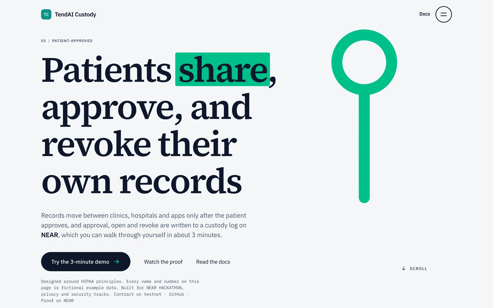
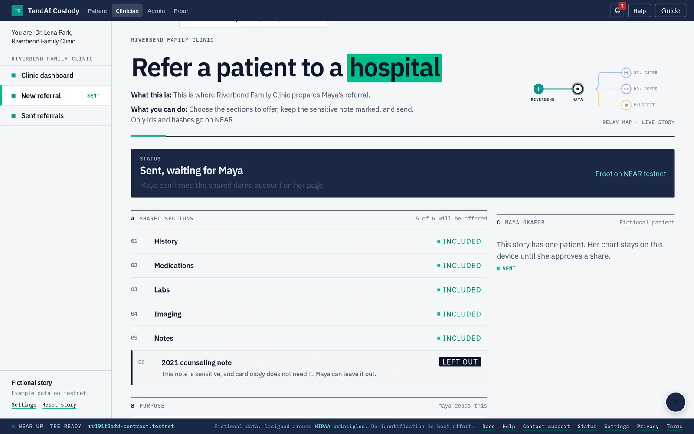
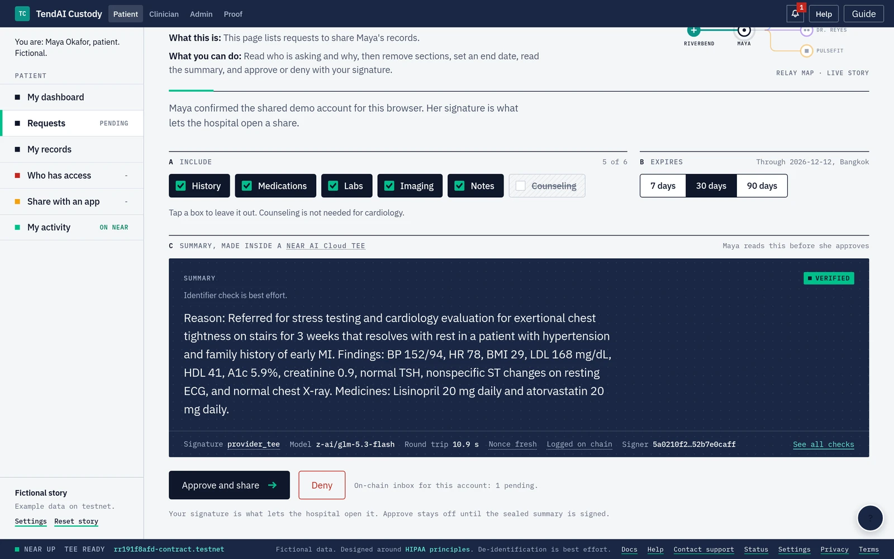
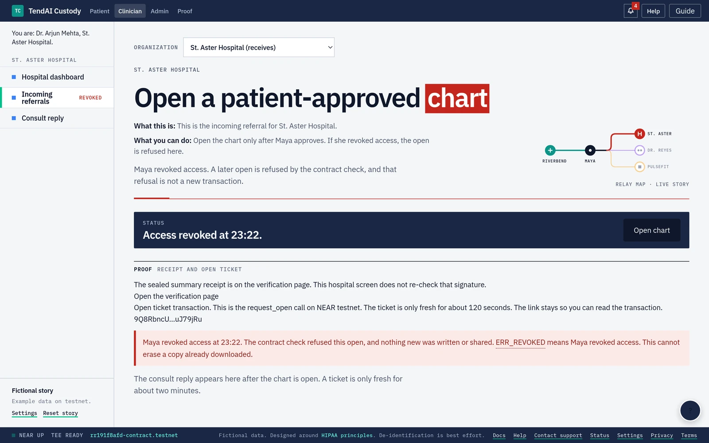
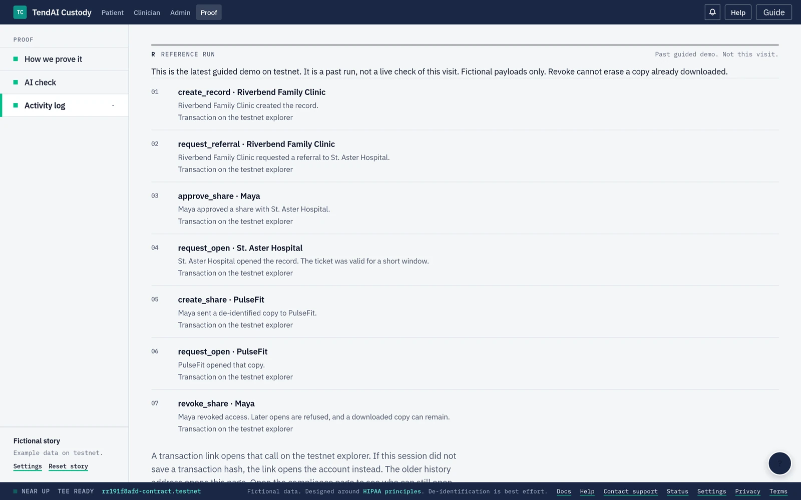
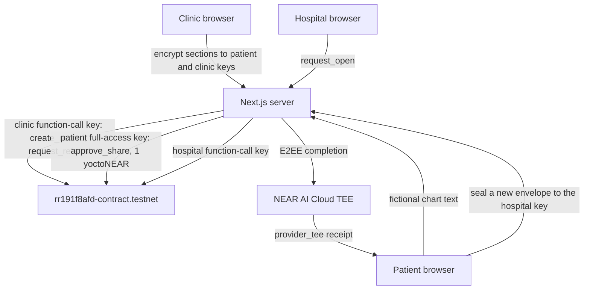

# TendAI Custody

Patient-approved record transfers from a clinic to a hospital, logged on NEAR testnet.

[](https://github.com/TendAILabs/tendai-custody-near/releases/download/v1.0-demo/tendai-custody-demo.mp4)

Demo video (1:15, mp4): [watch on the v1.0-demo release](https://github.com/TendAILabs/tendai-custody-near/releases/download/v1.0-demo/tendai-custody-demo.mp4). Live demo: https://tendaicustody.app

## Judges start here

TendAI Custody is a patient-approved referral from a clinic to a hospital, with a chain-of-custody record on NEAR testnet and a NEAR AI Cloud TEE summary.

```json
{
  "name": "TendAI Custody",
  "tracks": ["privacy", "security"],
  "primary_track": "privacy",
  "network": "testnet",
  "contract_id": "rr191f8afd-contract.testnet",
  "owner_id": "rr191f8afd-owner.testnet",
  "schema": 2,
  "event_standard": "referral_relay",
  "event_version": "2.0.0",
  "wasm_bytes": 278564,
  "wasm_sha256": "67b2ec90989a2f6b6afbebb1b77061b479c65f787943f82ac0cd61ab478e5d3b",
  "code_hash": "7yoEaxs7NvbbHSAw6wY91M1eMV488DocVXyBN5bQaxcz",
  "demo_url": "https://tendaicustody.app",
  "guided_demo": "https://tendaicustody.app/home?guide=1",
  "proof_url": "https://tendaicustody.app/onchain?desk=proof",
  "explorer": "https://testnet.nearblocks.io/address/rr191f8afd-contract.testnet",
  "repo": "https://github.com/TendAILabs/tendai-custody-near",
  "license": "MIT",
  "data": "fictional"
}
```

Privacy is the primary track. Security is the secondary track. The demo uses fictional data only. This build is testnet only. Two facts to keep in view: the contract account still has one full-access key, so that key can deploy new code, and `POST /api/tee/summary` sees the chart text before the TEE call.

### 90 seconds, no keys

Open https://tendaicustody.app and start the Guided Demo at https://tendaicustody.app/home?guide=1. You do not need a wallet or a key. The demo server signs. You play each person in one fictional referral. You should see:

1. Maya's page, then a send from Riverbend Family Clinic with a testnet transaction link. The contract stores section hashes, not chart text.
2. A summary, then Approve and share. That transaction attaches 1 yoctoNEAR. The summary is kept only when the receipt says `provider_tee`.
3. St. Aster Hospital opens the chart. That is a `request_open` transaction.
4. Maya revokes. The next hospital open is refused.
5. The proof page https://tendaicustody.app/onchain?desk=proof shows the activity for that story.

The same path, written as separate steps, is the 3-minute walk below. A production retest of it on 2026-11-14 is in the claim map. Each hash was read back from `https://rpc.testnet.near.org` before it was written here.

### RPC checks, no keys

These reads use the public testnet RPC. They do not sign. `view_code` returns the wasm. Read `result.hash`. Do not paste the wasm into a note.

```bash
RPC=https://rpc.testnet.near.org
CONTRACT=rr191f8afd-contract.testnet

curl -s "$RPC" -H 'content-type: application/json' -d "{\"jsonrpc\":\"2.0\",\"id\":\"1\",\"method\":\"query\",\"params\":{\"request_type\":\"call_function\",\"finality\":\"final\",\"account_id\":\"$CONTRACT\",\"method_name\":\"get_owner\",\"args_base64\":\"e30=\"}}"

curl -s "$RPC" -H 'content-type: application/json' -d "{\"jsonrpc\":\"2.0\",\"id\":\"1\",\"method\":\"query\",\"params\":{\"request_type\":\"call_function\",\"finality\":\"final\",\"account_id\":\"$CONTRACT\",\"method_name\":\"list_actors\",\"args_base64\":\"eyJmcm9tX2luZGV4IjowLCJsaW1pdCI6MjB9\"}}"

curl -s "$RPC" -H 'content-type: application/json' -d "{\"jsonrpc\":\"2.0\",\"id\":\"1\",\"method\":\"query\",\"params\":{\"request_type\":\"view_code\",\"finality\":\"final\",\"account_id\":\"$CONTRACT\"}}"
```

`get_owner` returns `rr191f8afd-owner.testnet`. `list_actors` returns six active actors. `view_code` `result.hash` is `7yoEaxs7NvbbHSAw6wY91M1eMV488DocVXyBN5bQaxcz`. The wasm is 278,564 bytes. Its SHA-256 is `67b2ec90989a2f6b6afbebb1b77061b479c65f787943f82ac0cd61ab478e5d3b`, the same value `deploy-kit/README.md` records for `deploy-kit/referral_relay.wasm`. That file and the bytes returned by `view_code` have the same SHA-256.

Function-call methods, one account at a time. Swap the account id. Expect `FunctionCall.method_names` on receiver `rr191f8afd-contract.testnet`. The clinic key cannot call `request_open`. Hospital and second opinion can. PulseFit can call only `request_open`.

```bash
PREFIX=rr191f8afd
for ROLE in clinic hospital second lakeside pulsefit patient owner contract
do
  ACCOUNT="${PREFIX}-${ROLE}.testnet"
  echo "== $ACCOUNT"
  curl -s "$RPC" -H 'content-type: application/json' -d "{\"jsonrpc\":\"2.0\",\"id\":\"1\",\"method\":\"query\",\"params\":{\"request_type\":\"view_access_key_list\",\"finality\":\"final\",\"account_id\":\"$ACCOUNT\"}}"
  echo
done
```

The 3-minute walk, if you click through the demo:

1. Open the Guided Demo. Choose the demo server account on Maya's page. The page continues as the patient.
2. Send the referral as Riverbend Family Clinic. The clinic step shows a testnet transaction. The contract stores section hashes, not chart text.
3. As Maya, run Check with secure AI, then Approve and share. The approval transaction attaches 1 yoctoNEAR. The summary is kept only when the receipt says `provider_tee`.
4. Open the chart as St. Aster Hospital. The open is a `request_open` transaction, then the summary is shown.
5. Revoke St. Aster Hospital as Maya. That is a `revoke_share` transaction with 1 yoctoNEAR.
6. Open the chart again as the hospital. The contract refuses the open.
7. Open the proof page and read the activity log.

A production retest of that path on 2026-11-14 is in the claim map below. Each hash was read back from `https://rpc.testnet.near.org` before it was written here.

## What it does

A clinic sends a referral. The patient approves a narrower share. The hospital opens that share while it is active. Each of those steps is a call on the NEAR contract `rr191f8afd-contract.testnet`. The contract stores account ids, organization display names, section hashes, scope, expiry, status, and open counters. It does not store chart text.



The clinic browser encrypts each section to the patient and clinic public keys stored on the contract. On approval, the patient browser seals a new envelope to the hospital public key from the contract. NEAR AI Cloud writes the summary inside a TEE. A separate de-identification pass strips a fictional copy for the PulseFit app. The TEE does not hold the hospital wrap key.



The patient can revoke the share. The next open is refused. A copy that was already downloaded stays where it was saved.



## Real and simulated

Live means a testnet account, a testnet transaction, or a call this demo makes to NEAR AI Cloud. Fictional means the people and the chart. Simulated means the product shows a check it did not run, or the chain stores a hash it does not verify. The same split is on the docs page at `/docs`.

| Piece | Kind | Where this is grounded |
| --- | --- | --- |
| `rr191f8afd-contract.testnet`, schema 2, owner `rr191f8afd-owner.testnet` | Live on testnet | `get_owner` and `list_actors` on 2026-11-14. `deploy-kit/provision.sh` names the accounts. |
| `create_record`, `request_referral`, `approve_share`, `request_open`, `revoke_share`, and a refused open | Live on testnet | Claim map below, and [docs/ATTACK-DEMO-RESULT.md](docs/ATTACK-DEMO-RESULT.md), 11 of 11. Fictional payloads. |
| NEP-297 events, standard `referral_relay`, version `2.0.0` | Live on testnet | `contract/src/events.rs`. Test `register_create_and_referral_events`. |
| Section encryption in the browser | Live crypto, demo keys | `web/lib/crypto/envelope.ts`. The clinic send wraps to the patient and the clinic. Approve seals a new envelope to the hospital public key. `rewrapEnvelope` is covered by `re-wrap to a second recipient works`. The approve path calls `encryptEnvelope`. |
| NEAR AI Cloud summary on `z-ai/glm-5.3-flash` | Live call, fictional chart | `web/lib/tee/live.ts`. Kept only for `signatureKind` `provider_tee`. The server sees the chart text in that request. |
| Maya Okafor, the clinics, the hospital, PulseFit, and every chart | Fictional | `fixtures/personas.json` and `web/lib/fixtures.ts`. |
| Guided Demo signing | Server-held demo keys | `web/lib/near/sign-handler.ts`. The request cannot pick an account id. |
| On-chain `tee_receipt_hash` | Hash only. The chain does not verify the TEE | `contract/DESIGN-V2.md`. The app checks `provider_tee` before it will approve from this server. |
| Verification page rows for the gateway quote, RTMR3, nonce binding, and model measurements | Not checked on that page | `web/lib/near/proof.ts` marks those rows `not-checked`. |
| Attack list on the proof page | A recording, not a live run of this page view | `web/components/wireframe/activity/verify-panel.tsx`. The source table is `docs/ATTACK-DEMO-RESULT.md`. |
| Nonce replay, key substitution, and a flipped ciphertext byte | Local checks in the attack script | `docs/ATTACK-DEMO-RESULT.md`. Those three rows have no transaction. |
| Landing quotes such as Event 0001 | Example copy | `web/components/landing/proof.tsx` labels them example data. |
| `TESTNET_CONTRACT` in `web/lib/fixtures.ts` | Older account id still in that fixture | The constant is `rr6c9910d7.testnet`. The running server reads `RELAY_CONTRACT_ID`. This README names the schema 2 account. |

## Claim map



Production retest, 2026-11-14, contract `rr191f8afd-contract.testnet`. RPC `tx` with `wait_until` `NONE` returned success for each row. `create_record` returned record id `9`. `request_referral` returned share id `17`. `approve_share` and `revoke_share` attached a deposit of 1 yoctoNEAR. After the revoke, `get_share` for share 17 returned `status` `Revoked` and `open_count` 1.

| Claim | Code | Test | Transaction |
| --- | --- | --- | --- |
| A clinic creates a record of section hashes. An unregistered account and a patient account cannot. | `contract/src/lib.rs` `create_record` | `unregistered_account_cannot_create_record`, `patient_cannot_create_record` | [create_record](https://testnet.nearblocks.io/txns/8kHgU6ukSZat9RQGXVkpK4e4ouLfAA26wVK8gXeTPTny) by the clinic account. Deposit 0. Result `"9"`. |
| The creating clinic requests a referral to the hospital account. | `contract/src/lib.rs` `request_referral` | `creation_request_id_replays_and_conflicts` | [request_referral](https://testnet.nearblocks.io/txns/CLnePCT5CxoVso15wT6ZDiQxybeX1BeTAQ51Q58YP6TP) by the clinic account. Deposit 0. Result `"17"`. |
| The patient approves a narrower share. The call requires exactly 1 yoctoNEAR. | `contract/src/lib.rs` `approve_share` | `approve_without_one_yocto_fails`, `approve_narrows_scope_and_sets_active` | [approve_share](https://testnet.nearblocks.io/txns/AafFqXhqxe9bB3LPZRiHftGmE7C2voZPXjRZRRj9zrLL) by the patient account. Deposit 1. |
| The hospital opens an active share. Another account is refused. | `contract/src/lib.rs` `request_open` | `open_by_recipient_and_check_ticket_window`, `unauthorized_open_is_rejected` | [request_open](https://testnet.nearblocks.io/txns/8H6iPhgxGjwN968jwzARRafNUzuWcCJmGKzshxT41P6Q) by the hospital account. Deposit 0. |
| Revoke marks the share revoked. A later open panics `ERR_REVOKED`. | `contract/src/lib.rs` `revoke_share`, `assert_share_openable` | `revoke_then_open_fails` | [revoke_share](https://testnet.nearblocks.io/txns/J6PRGT4jPUuSiC7SahcpSLbNtASCQi5jSSDpDAZbHoSp) by the patient account. Deposit 1. Share 17 then reads `Revoked`. The refusal on this same share was not given a separate hash in the retest notes. A different run's refused open is verified below. |
| The app accepts `approve_share` only with a summary receipt that this server issued for that session, share, and summary hash. The contract still accepts any 64-hex receipt. | `web/lib/session/visitor.ts` `claimSummaryReceipt`, `contract/src/lib.rs` `try_decode_hash` | `M1 the server summary hash is canonical and approve rejects any other 64-hex receipt` | App check. No separate chain transaction. |
| A summary is kept only for `signatureKind` `provider_tee`. | `web/lib/tee/live.ts` `teeSummary` | `a missing provider_tee receipt and a short answer are not retried` | Model call. The receipt hash is an argument of the approve transaction above. |
| PulseFit signs `request_open` with the function-call key. A missing key returns HTTP 500 `signer not configured` and does not sign. | `web/lib/near/sign-handler.ts` `SIGNER_ENV` | `PulseFit signing uses the function-call key and fails closed when it is missing`, `app code never reads the PulseFit full-access key` | The hosted app does not send the PulseFit full-access key. |
| A replayed open nonce is HTTP 403. | `web/lib/open/handle.ts` | `replayed nonce gives 403` | Local to the server. The attack demo records the same check with no transaction. |
| Fresh state is schema 2. There is no migrate method. Events are NEP-297 `referral_relay` `2.0.0`. | `contract/src/lib.rs` `SCHEMA_VERSION`, `contract/src/events.rs` | `fresh_state_is_schema_v2_without_a_migration_path`, `register_create_and_referral_events` | `get_owner` on the live contract returns `rr191f8afd-owner.testnet`. |

The attack demo on 2026-11-14, recorded in [docs/ATTACK-DEMO-RESULT.md](docs/ATTACK-DEMO-RESULT.md), passed 11 of 11 on this contract. The refused open [CGaCe4yTiSc5uc9Rtwuc82BFy72bZ5sbdwq8r4QjGf8L](https://testnet.nearblocks.io/txns/CGaCe4yTiSc5uc9Rtwuc82BFy72bZ5sbdwq8r4QjGf8L) was re-read on RPC: `request_open` signed by the hospital account, execution error `Smart contract panicked: ERR_REVOKED`.

## Architecture



Stack, from the lockfiles and manifests:

| Layer | What this repo pins |
| --- | --- |
| Contract | Rust, `near-sdk` 5.30.1, `rust-version` 1.99. Built with cargo-near. The reproducible image in `contract/Cargo.toml` is `sourcescan/cargo-near:0.22.0-rust-1.99.1`. Contract tests were run with the cargo-near 0.23.0 binary. |
| Web | Next.js 16.4.5, `near-api-js` 7.4.0, `@hot-labs/near-connect` 0.12.0, `@nearai/inference-sdk` 0.3.0. Package manager `pnpm@10.15.0`. |
| Model | `z-ai/glm-5.3-flash`. `web/lib/relay/policy.ts` `assertTeeModel` refuses any other id, including `openai/`, `anthropic/`, `google/`, and `gemini/` prefixes. |

Schema is 2 (`SCHEMA_VERSION` in `contract/src/lib.rs`). `new` takes an owner that is a different account. There is no migrate method and no method that replaces the wasm. NEP-297 standard name `referral_relay`, event payload version `2.0.0` (`contract/src/events.rs`). The wasm in `deploy-kit/referral_relay.wasm` is 278,564 bytes, SHA-256 `67b2ec90989a2f6b6afbebb1b77061b479c65f787943f82ac0cd61ab478e5d3b`. The bytes on `rr191f8afd-contract.testnet` match that hash. Custody history for a record is the NEP-297 events plus `open_count` and `last_opened_ns`. Schema 2 has no `get_timeline`.

What the server writes, and how long it keeps it, is in [docs/server-stores.md](docs/server-stores.md).

The contract role enum is Clinic, Patient, or App. St. Aster Hospital, Northgate Heart Institute, and Lakeside Family Medicine are stored as Clinic. Display names distinguish them. `list_actors` on 2026-11-14 returned six active actors.

Function-call keys were read with `view_access_key_list` on 2026-11-14. Each key is limited to this contract. `deploy-kit/provision.sh` grants a 1 NEAR allowance. The hosted signer is `web/lib/near/sign-handler.ts` `SIGNER_ENV`. The method lists match `web/lib/near/sign-allow.ts`, covered by `kit method lists match the sign allow list`.

| Role | Account | Hosted signer env | On-chain function-call methods |
| --- | --- | --- | --- |
| Clinic (Riverbend) | `rr191f8afd-clinic.testnet` | `CLINIC_A_FC_PRIVATE_KEY` | `create_record`, `request_referral` | <!-- pragma: allowlist secret -->
| Hospital (St. Aster) | `rr191f8afd-hospital.testnet` | `HOSPITAL_B_FC_PRIVATE_KEY` | `request_open`, `submit_reply` | <!-- pragma: allowlist secret -->
| Second opinion (Northgate) | `rr191f8afd-second.testnet` | `SECOND_OPINION_FC_PRIVATE_KEY` | `request_open`, `submit_reply` |
| Lakeside | `rr191f8afd-lakeside.testnet` | The web signer has no Lakeside role | `create_record`, `request_referral` |
| PulseFit | `rr191f8afd-pulsefit.testnet` | `PULSEFIT_FC_PRIVATE_KEY` | `request_open` |
| Patient | `rr191f8afd-patient.testnet` | `DEMO_PATIENT_PRIVATE_KEY` (full access) | A function-call key also lists `approve_share`, `decline_share`, `create_share`, `revoke_share`, `revoke_all_for_record`. The hosted signer does not use that key. | <!-- pragma: allowlist secret -->

`staff_method_names` returns `create_record`, `request_referral`, `request_open`, `request_owner_open`, and `submit_reply`. That is the contract constant `STAFF_METHODS`. It lists more than any one key allows. The clinic function-call key cannot call `request_open` or `request_owner_open`, so a clinic staff key cannot open a share. Hospital and second-opinion keys can call `request_open` and `submit_reply`. They cannot approve, decline, or revoke. PulseFit signs with `PULSEFIT_FC_PRIVATE_KEY` (the function-call key in use since that swap). That key lists only `request_open`.

Names ending in `_FULL_PRIVATE_KEY`, and `RELAY_OWNER_PRIVATE_KEY`, are for local tooling (`scripts/setup-testnet.ts`, `scripts/pulsefit-fc-key.ts`, `deploy-kit/provision.sh`). Production and Preview code does not read them. As of 2026-11-14 they are off Production and Preview. They remain for local tooling and Development only. The patient key the hosted app does read is `DEMO_PATIENT_PRIVATE_KEY`.

## Security

Read [SECURITY.md](SECURITY.md). The attack demo result is [docs/ATTACK-DEMO-RESULT.md](docs/ATTACK-DEMO-RESULT.md): 11 of 11 passed on 2026-11-14. Limits that stay visible are in [docs/KNOWN-LIMITS.md](docs/KNOWN-LIMITS.md).

## Tests

Counts are from this working tree on 2026-11-14. Node was v22.23.4. Rust was 1.99.1. cargo-near was 0.23.0.

| Command | Where | Result |
| --- | --- | --- |
| `cargo +1.99.1 test --lib` | `contract/` | 50 passed, 0 failed |
| `cargo +1.99.1 test --test sandbox` | `contract/` | `sandbox_custody_rules` passed. `sandbox_v2_scale` had not finished when this file was written. See the note under the table. |
| `node --experimental-strip-types --test "lib/**/*.test.ts"` | `web/` | 344 passed, 0 failed |
| `RELAY_CONTRACT_ID=rr191f8afd-contract.testnet NEAR_NETWORK=testnet NEAR_RPC_URL=https://rpc.testnet.near.org node --experimental-strip-types scripts/phi-scan.ts` | repo root | `schema=2 actors=6 records=9 shares=17 events=0 status=complete terms=50 hits=0` |
| gitleaks 8.30.1 `detect --redact --no-banner` | repo root | no leaks found |

The first sandbox run failed before any assertion because `cargo-near` was not on `PATH` (`error: no such command: near`). After installing cargo-near 0.23.0, `sandbox_custody_rules` passed. `sandbox_v2_scale` runs 1,000 referrals, 1,000 extra records, and 1,000 opens inside a local sandbox. It was still inside that loop when this README was written, so this file does not mark it passed.

`phi-scan` reads public contract state and greps `docs/e2e-log.md` plus local server logs, when those files exist, for fixture identifiers. The code default RPC is `https://test.rpc.fastnear.com` (`scripts/lib/chain.ts`). This run set `NEAR_RPC_URL` to `https://rpc.testnet.near.org`.

`pnpm attack-demo` signs testnet transactions. It was not re-run. The last recorded run is the 11/11 file linked above. Signing keys are not in this environment.

Env names and empty values are in [.env.example](.env.example). What the hosted app reads is in [docs/env-vars.md](docs/env-vars.md). Put values only in an env file you do not commit.

## Limits

This demo is designed around HIPAA principles (patient authorization, minimum necessary, access logs).

Revoking a share blocks a later open through this system. It cannot erase a copy that was already downloaded.

Removing identifiers is best effort, with a preview. The patient should read that preview before sending the stripped copy.

Testnet only. Fictional data only. This is not a live clinic system.

The Guided Demo keeps the patient signing key and `DEMO_ENC_SEED` on the server. The open route can decrypt a demo envelope with that seed. A local device key is a different path (`web/lib/wallet/keys.test.ts`, `a device key stays off the public view and signs without sending the secret`).

The contract checks that a receipt hash is 64 hex characters. It does not check a TEE certificate. The server-issued binding is enforced by this app.

`revoke_share` changes that share. It does not revoke child shares. `revoke_all_for_record` bumps the record grant epoch. Shares from an older epoch are effectively revoked. The call does not walk them (`contract/DESIGN-V2.md`).

## Hackathon

Built for [NEAR HACKATHON](https://nearhackathon.com). Primary track: privacy (private AI, TEE, NEAR AI Cloud). Secondary track: security (function-call keys, and a `provider_tee` receipt check before approve).

The GitHub repository was created 2026-11-09. This tree has no pre-hackathon baseline.

The product calls NEAR AI Cloud. AI tools used: Cursor, Claude, GPT, Codex, OpenRouter, Gemini, and Grok. Libraries are the stack table above.

## Other entry (Q-015 disclosure)

The same submitter also entered [TrueNav](https://truenav.app) in NEAR HACKATHON. The two projects are independent, with separate code, contracts and deployments, and neither depends on the other.

## Spend

`web/lib/tee/spend.ts` sets `SPEND_STOP_USD` to 4 and `SPEND_CAP_USD` to 5. A call is refused when the next estimate would pass $4. NEAR AI spend for this project was well under $1. The stop is covered by `stop triggers when the next estimate passes $4`.

## License

MIT. See [LICENSE](LICENSE).
